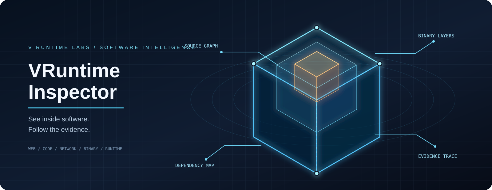
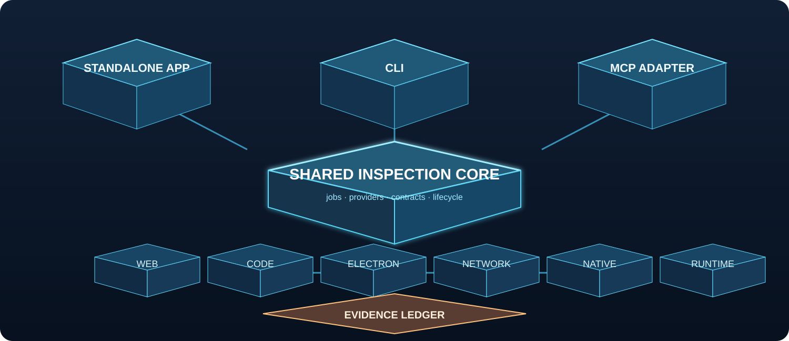
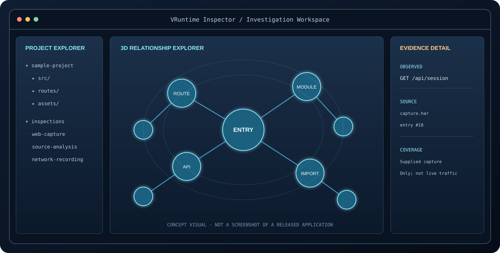
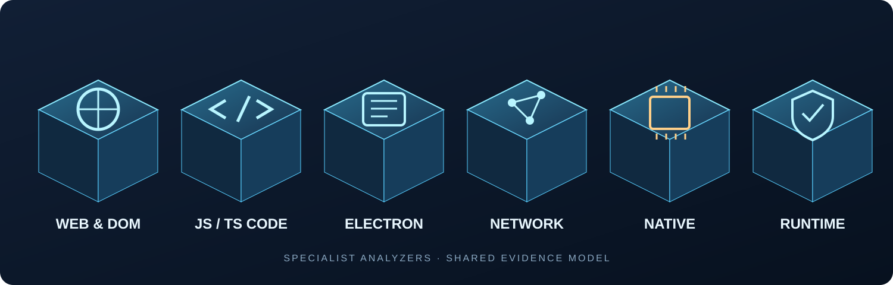
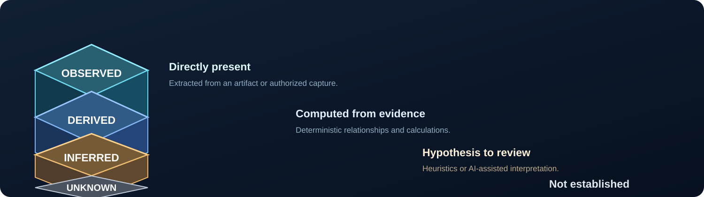
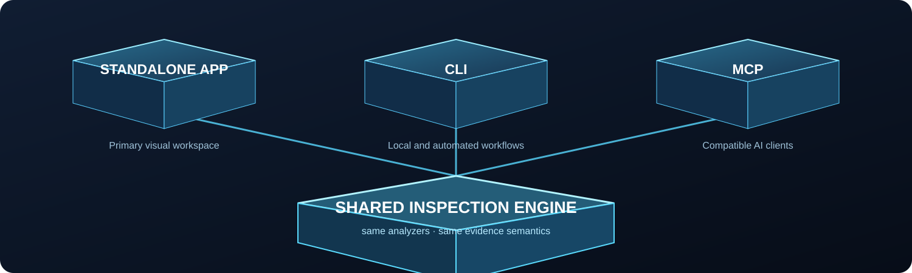

<h1>VRuntime Inspector</h1>

<strong>See inside software. Follow the evidence.</strong>

  An open-source, AI-first software investigation tool. Connect its remote MCP server to compatible AI and vibe-coding tools, or inspect a public website in the hosted workbench. The connected AI uses its own model and usage plan to reason and generate code.

  <a href="#hosted-cloud-workbench"><strong>Hosted Workbench</strong></a> ·
  <a href="#inspection-domains"><strong>Inspection Domains</strong></a> ·
  <a href="#how-it-fits-together"><strong>Architecture</strong></a> ·
  <a href="#integrations"><strong>AI &amp; Developer Integrations</strong></a> ·
  <a href="#responsible-use"><strong>Responsible Use</strong></a>

  
  
  

---

## What is VRuntime Inspector?

**VRuntime Inspector** is an open-source software investigation and reverse-engineering workbench. Its goal is to bring multiple inspection disciplines into one coherent application, backed by a shared engine and a traceable evidence model.

It is being designed to examine software artifacts such as web captures, JavaScript and TypeScript projects, Electron packages, network recordings, and native executable files. The depth of inspection depends on the artifact, available metadata, configured tools, and permissions.

The project has three access paths:

- **AI integrations (MCP)** — the primary interface for compatible AI assistants and vibe-coding tools. The Inspector supplies inspection tools and evidence; the connected AI uses its own model and credits to plan and generate application code.
- **Hosted web workbench** — inspect a public website from a browser and export an AI-ready reconstruction brief. No local server is required for this workflow.
- **Local CLI and workbench** — analyze local source files and supplied artifacts such as HAR captures on the developer’s own machine.

These interfaces share inspection capabilities. VRuntime Inspector does not provide an AI model, code-generation credits, or a separate AI subscription.

> **Project status:** VRuntime Inspector is in early development. The architecture and module descriptions below communicate the intended direction; they are not a claim that every inspector, integration, or security control is already implemented. Follow the repository and release notes for verified availability.

## The inspection idea

  

A typical investigation follows a simple path:

1. **Bring an artifact** — provide a URL, source tree, browser capture, HAR file, package, or binary that you are authorized to inspect.
2. **Choose an inspection** — select a domain-specific analyzer and the scope it is allowed to access.
3. **Collect observations** — extract facts from the supplied artifact or an explicitly authorized target.
4. **Connect the evidence** — build relationships such as imports, routes, endpoints, package contents, and dependencies where the available data supports them.
5. **Review and export** — inspect provenance, coverage, uncertainty, and limitations before generating a report.

## Hosted cloud workbench

The hosted beta is designed for developers who cannot or do not want to run a local server. Open the [VRuntime Inspector Cloud Workbench](https://vruntime-inspector-cloud.vruntimelabs.workers.dev/), paste a public website URL, choose a small page limit, and start an inspection. It returns an evidence-backed Markdown brief that can be copied or downloaded and supplied to an AI coding assistant.

The same service exposes a remote MCP endpoint for compatible clients:

- **MCP endpoint:** `https://vruntime-inspector-cloud.vruntimelabs.workers.dev/mcp`
- **Transport:** Streamable HTTP
- **Initial tools:** `inspect_website`, `get_inspector_capabilities`
- **AI billing:** the Inspector does not call an LLM. Your connected AI uses its own model and usage allowance for reasoning and code generation.

The deployed hosted beta currently offers two modes: Quick Scan performs bounded passive HTML inspection; Deep Investigation adds bounded same-origin JavaScript and CSS source analysis. Deep Investigation does not execute target JavaScript; it analyzes downloaded text assets only. The runtime-investigation feature branch adds `runtime_inspect_website`, an isolated browser capture with screenshot, rendered DOM, accessibility, console and same-origin GET/HEAD observations. The branch also adds up to eight explicitly approved, bounded click/hover/safe-key/scroll actions with before/after state summaries. The optional Cloudflare Browser Run binding is not live on the deployed Worker yet. It does not inspect private backend code, databases or authenticated sessions. See [hosted service details](apps/cloudflare/README.md) for exact limits and client compatibility notes. ChatGPT custom MCP availability depends on the ChatGPT plan and supported connector features; users on plans without custom MCP access can use the hosted workbench to export a brief and upload it into ChatGPT.

## Standalone workbench

  

The local workbench complements the hosted web interface. It is intended for artifacts that should remain on the developer’s own machine, such as local HAR files and source trees.

The intended workbench brings the investigation into one place:

- Artifact intake and project workspaces.
- Inspection runs with visible scope and status.
- A 3D relationship explorer for dependencies, routes, modules, and other discovered structures.
- Evidence details with source references and confidence boundaries.
- Searchable findings, comparison views, and report export.
- Local-first workflows for private files and artifacts wherever the selected inspector can run locally.

The 3D explorer is a way to navigate relationships, not a substitute for the underlying evidence. Every meaningful graph item should lead back to the observation or derivation that supports it.

*The illustration above is a product-direction visual, not a screenshot of a released application.*

## Inspection domains

  

| Domain | Planned inspection focus |
| --- | --- |
| **Web & DOM** | Analyze supplied browser captures or authorized live targets; inspect DOM and accessibility structure, identify visible technologies, and map discovered resources and routes. |
| **JavaScript & TypeScript** | Parse source files, map imports and entry points, inspect AST structures, and examine available source maps. |
| **Electron** | Examine authorized application packages, ASAR contents, main/renderer structure, IPC patterns, and security-related configuration. |
| **Network & APIs** | Import and compare HAR recordings, inventory observed requests and endpoints, and redact sensitive values in supported outputs. |
| **Native binaries** | Read supported ELF, PE, and Mach-O metadata; optionally integrate with external analysis engines such as Ghidra when separately installed and configured. |
| **Runtime behavior** | Observe explicitly authorized targets through supported instrumentation and controlled scenarios. Runtime inspection is opt-in and depends on the configured provider. |

These are module families, not promises of complete coverage. Obfuscation, missing symbols, incomplete captures, inaccessible resources, platform differences, and unavailable tools can all limit results.

## Evidence model

  

VRuntime Inspector is designed to distinguish what an analyzer directly found from what it computed or merely suspects.

| Classification | Meaning | Example |
| --- | --- | --- |
| **Observed** | Directly present in the supplied artifact or captured by an authorized inspection. | A request URL in a HAR entry; a section listed in a PE header. |
| **Derived** | Deterministically computed from observations. | An import relationship resolved from parsed source files. |
| **Inferred** | A heuristic or AI-assisted interpretation that needs review. | A possible framework identification based on several indicators. |
| **Unknown** | Not established by the available evidence. | A behavior hidden by obfuscation or a runtime path not exercised. |

Evidence records are intended to carry provenance, timestamps, artifact or target references, coverage information, and limitations. **An absence of evidence is not proof that something is absent.** Reports must preserve that distinction.

## How it fits together

  

The intended architecture separates user interfaces from inspection logic:

- **Applications** provide the standalone workbench and CLI.
- **Adapters** expose shared workflows through web, command-line, and MCP interfaces.
- **Contracts** define stable input, output, and error shapes.
- **Core** coordinates inspection jobs, providers, cancellation, and lifecycle.
- **Inspectors** implement domain-specific analysis.
- **Evidence** records provenance, classifications, coverage, and limitations.

This separation is intended to keep behavior consistent: a finding produced through the workbench should have the same meaning when requested through the CLI or an MCP client.

## Integrations

### AI clients through MCP

MCP is the primary AI integration surface. The deployed hosted beta exposes a remote Streamable HTTP server with bounded static website inspection and capability-discovery tools. The runtime-investigation feature branch adds `runtime_inspect_website` for initial browser capture and bounded explicitly approved interaction steps when the optional Browser Run binding is configured. The connected AI decides how to use the returned evidence and generates code using its own model and usage plan.

Potential tool families include:

| Tool family | Intended action |
| --- | --- |
| `web.*` | Inspect supplied captures or authorized web targets. |
| `js.*` | Analyze source files, imports, and AST structures. |
| `electron.*` | Inspect supported Electron package artifacts. |
| `network.*` | Import, redact, and compare HAR recordings. |
| `binary.*` | Read supported executable metadata and configured analysis results. |
| `runtime.*` | Run explicitly approved observation scenarios. |
| `evidence.*` | Retrieve, filter, and export evidence records. |

The hosted beta implements the current Streamable HTTP protocol revision `2026-07-28` and accepts the legacy initialize handshake for older clients. Local stdio transport is planned but is not yet shipped. Client support varies; test the endpoint with the target AI client before relying on it for a production workflow.

### CLI

The CLI is intended for local inspection, automation, repeatable jobs, and export into machine-readable evidence bundles or human-readable reports. Commands and flags will be documented alongside the implemented release.

## Local-first by design

Private source trees, installed applications, local binaries, and browser sessions should not be silently uploaded to a hosted service. The architecture prioritizes local processing for workflows that need access to local artifacts.

Some capabilities may require optional external engines, browser instrumentation, or remote services. Those dependencies should be explicit, separately configured, and visible to the user. No proprietary engine should be silently installed or treated as a mandatory dependency.

## Security & responsible use

VRuntime Inspector is intended for software you own or are explicitly authorized to examine.

The implementation is being designed around these safeguards:

- Explicit approval before active operations, target mutation, or execution of foreign code.
- Clear distinction between passive artifact parsing and operations that launch processes, access networks, or write files.
- Input validation, bounded archive extraction, file-size limits, timeouts, cancellation, and cleanup.
- Secret redaction in supported imports, logs, and exports.
- Provenance and coverage reporting, including visible limitations.
- Authentication and transport protection before exposing remote services.
- No silent execution of inspected code and no claims that inspection bypasses DRM, authentication, or access controls.

These are project requirements, not a certification that every safeguard is already implemented. See [SECURITY.md](SECURITY.md) and [DISCLAIMER.md](DISCLAIMER.md) as they are added to the repository.

## Quick start

The hosted website-inspection beta is available alongside the first local inspection slice. The local slice includes a HAR inspector, CLI, evidence ledger, and a limited JavaScript module-reference scanner.

**Requirements:** Node.js 22 or newer. The CLI and static-analysis core use Node.js built-ins. The optional hosted browser provider uses Cloudflare’s `@cloudflare/puppeteer` package and Cloudflare Browser Run; it is not needed for local static-analysis commands.

~~~bash
# Run checks
npm test
npm run check

# Start the standalone workbench (loopback only)
npm run web

# CLI help and local file analysis
node apps/cli/src/index.js help
node apps/cli/src/index.js inspect-har ./capture.har
node apps/cli/src/index.js analyze-js ./src/main.js
~~~

Open http://127.0.0.1:4173 for the standalone workbench. Import a .har file up to 10 MiB to inventory captured requests and inspect redacted metadata.

See [Development](README-DEV.md), [Implementation Status](docs/IMPLEMENTATION_STATUS.md), and [Cloud Workbench details](apps/cloudflare/README.md) for exact scope and limitations. The JavaScript scanner is currently regex-based, not a full AST parser. Initial rendered-browser capture is implemented in the runtime-investigation feature branch but is not deployed or verified against a live Browser Run session yet. Multi-page runtime crawling, cross-viewport comparison, persistent evidence storage, full backend inspection, code generation and the other inspection domains are not shipped yet.

## Technical references & acknowledgements

VRuntime Inspector is an independently developed project informed by research into software inspection and reverse-engineering tools.

**REA** ([website](https://rea.tools/) · [GitHub repository](https://github.com/morluto/rea)) was studied as a technical reference during architectural research. Its approach to inspection orchestration, tool organization, and evidence-oriented workflows helped inform areas of design exploration.

REA is a reference project, not a component or dependency of VRuntime Inspector. This acknowledgement does not imply endorsement, affiliation, or code reuse. Any third-party source code considered for reuse will be reviewed individually for license compatibility, retained notices, and required attribution. Actual reuse, if any, will be documented in [THIRD_PARTY_NOTICES.md](THIRD_PARTY_NOTICES.md).

## Contributing

Contributions, issue reports, and thoughtful technical discussion are welcome. As the implementation takes shape, contribution guidance will describe development setup, package boundaries, testing expectations, and review requirements.

Please avoid reporting planned capabilities as existing features. Reproducible bug reports should include the artifact type, relevant environment details, steps to reproduce, and sanitized logs where possible.

## License

VRuntime Inspector is released under the [MIT License](LICENSE). Third-party components, if introduced, remain subject to their respective licenses and notices.
